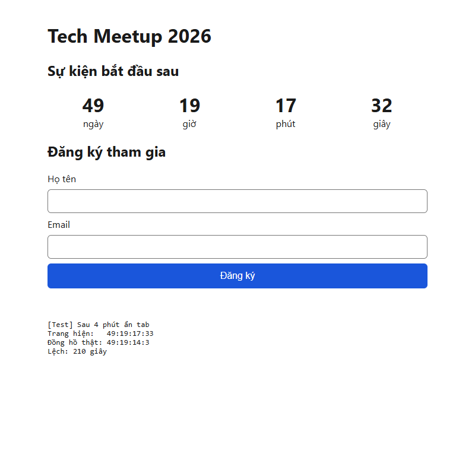
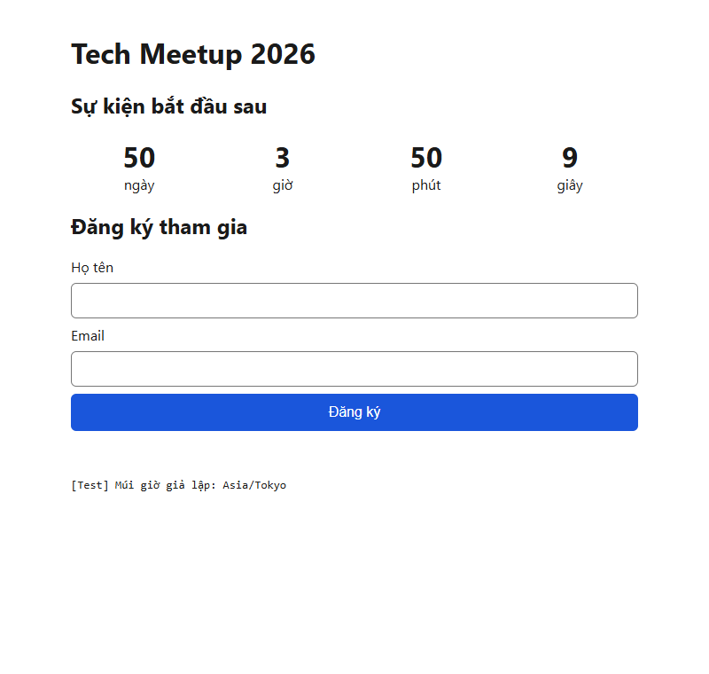
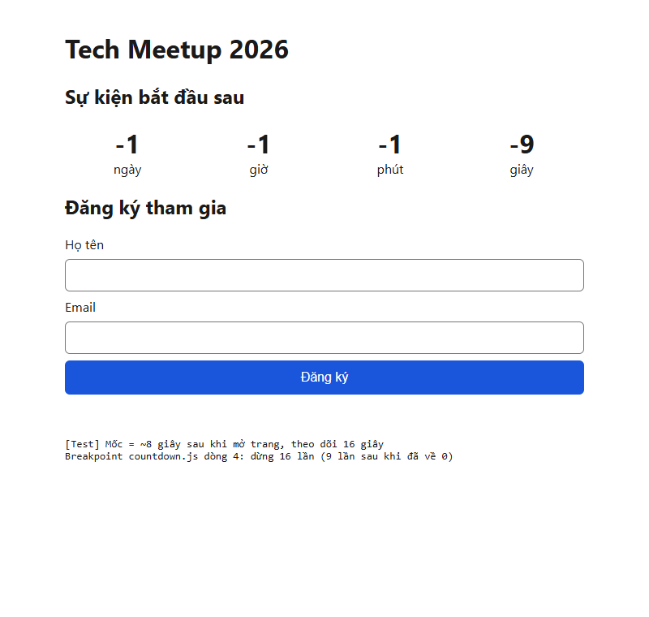
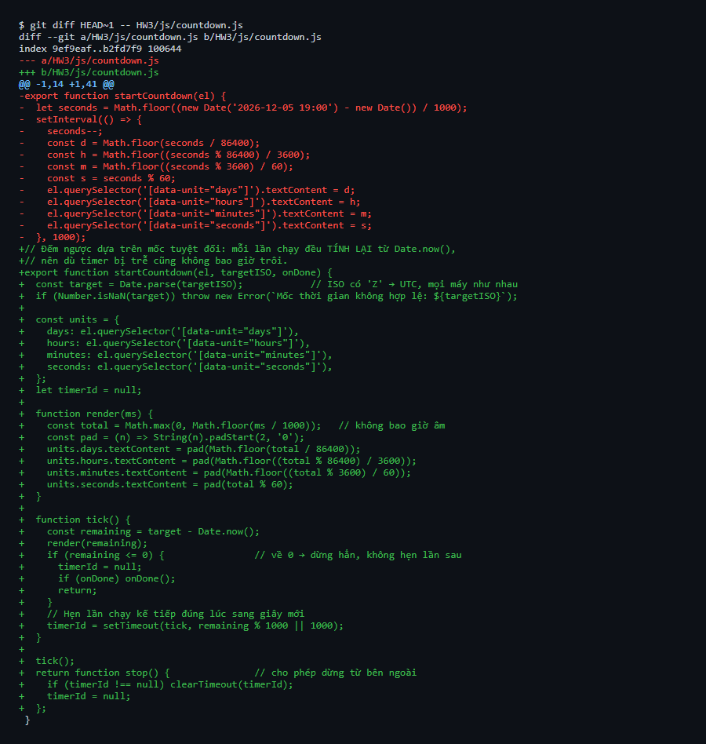
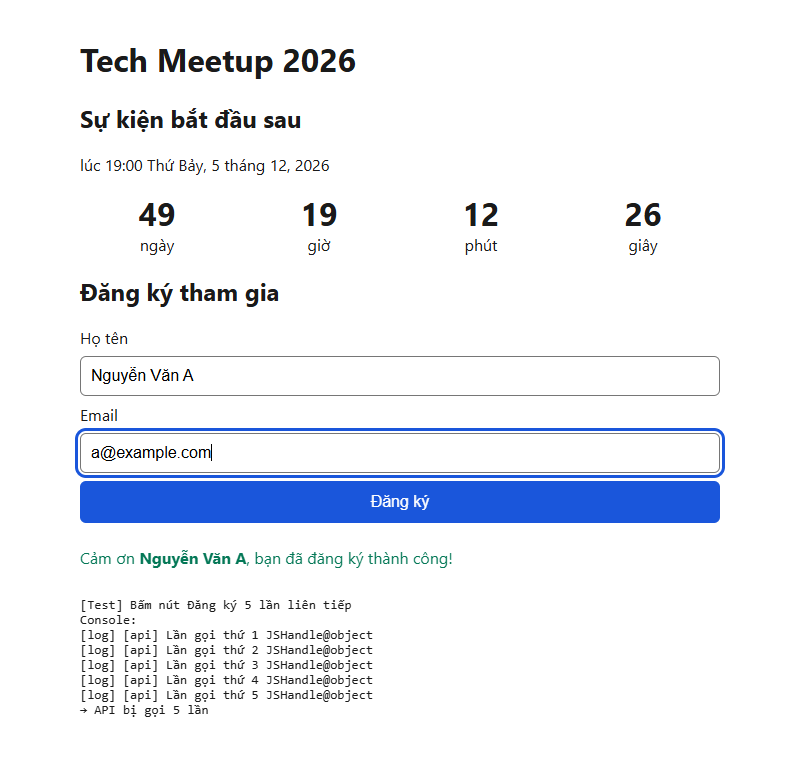
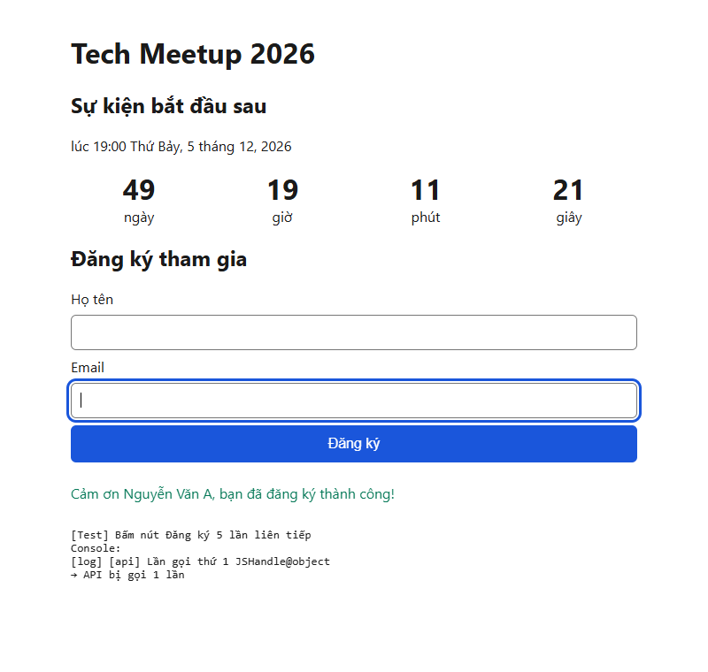
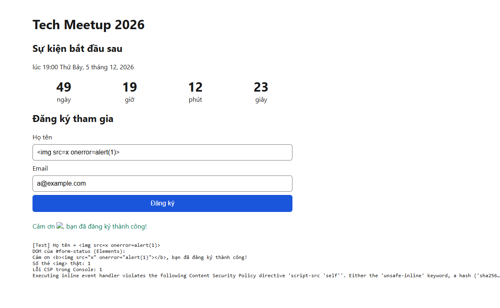
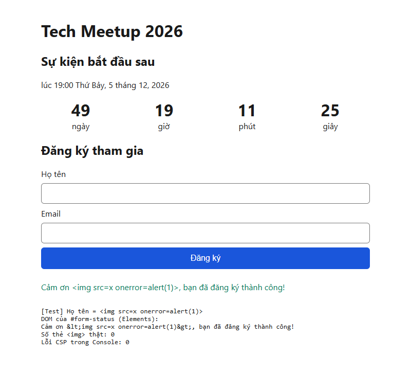

# AI Failure Audit – HW3

Bản nháp đầu tiên của từng slice được sinh bởi AI. Dưới đây là 3 lỗi tôi phát hiện
khi review, cách tôi chẩn đoán và cách tôi sửa.

> Ghi chú về cách kiểm thử: các bài test được chạy trên Chrome 155 thật, điều khiển bằng
> Chrome DevTools Protocol (Puppeteer) — cùng giao thức mà DevTools dùng cho breakpoint,
> giả lập múi giờ (Sensors) và Console. Dòng chữ nhỏ có tiền tố `[Test]` ở cuối mỗi ảnh
> là ghi chú do script kiểm thử chèn vào lúc chụp, không thuộc mã nguồn trang.

---

## Defect 1 – Countdown trôi giờ, sai múi giờ, rò rỉ timer

**Commit lỗi:** `9b3c86f` – wip(countdown): AI draft using setInterval
**Commit sửa:** `39a261c` – fix(countdown): drift-free UTC engine, stop timer at zero

### 1. Mô tả lỗi
Bản nháp có 3 lỗi chồng lên nhau:

- **Trôi giờ:** `seconds--` mặc định rằng `setInterval(..., 1000)` chạy đúng mỗi 1 giây.
  Trình duyệt không hứa điều đó: khi tab bị ẩn, Chrome làm chậm timer (có lúc chỉ chạy
  khoảng 1 lần/phút). Mỗi lần bị bỏ lỡ là một giây không được trừ, sai số cộng dồn mãi.
- **Sai múi giờ:** `new Date('2026-12-05 19:00')` không có múi giờ nên mỗi máy hiểu theo
  giờ địa phương của nó. Người ở Tokyo sẽ đếm về 19:00 giờ Tokyo, tức sớm hơn 2 tiếng so với
  sự kiện thật. Chuỗi này cũng không phải định dạng ISO chuẩn, một số trình duyệt có thể trả về `NaN`.
- **Rò rỉ timer:** `setInterval` không bao giờ bị `clearInterval`. Qua mốc 0, nó vẫn chạy
  mỗi giây, hiển thị số âm, và dòng "Sự kiện đã bắt đầu" không bao giờ hiện.

### 2. Cách chẩn đoán
- **Ẩn tab 4 phút**, mỗi phút so số trên trang với số giây còn lại thật (tính từ `Date.now()`):

  | Sau khi ẩn tab | 1 phút | 2 phút | 3 phút | 4 phút | Quay lại tab |
  |---|---|---|---|---|---|
  | Bản nháp – lệch (giây) | 32 | 91 | 150 | 209 | **210** |
  | Bản sửa – lệch (giây) | 1 | 58 | 58 | 58 | **0** |

  Bản nháp chậm thêm khoảng 1 phút cho mỗi phút ẩn tab và giữ nguyên độ lệch sau khi quay lại.
  Bản sửa chỉ hiện số cũ trong lúc bị ẩn, ngay lần chạy kế tiếp là đúng lại (lệch 0).

  

  *Lưu ý:* lần đo đầu tiên của tôi cho kết quả lệch 0–1 giây vì Puppeteer mặc định bật cờ
  `--disable-background-timer-throttling` (tắt đúng cơ chế làm chậm timer cần kiểm tra).
  Tôi loại bỏ kết quả đó và đo lại với Chrome ở cấu hình bình thường.

- **Giả lập múi giờ** (DevTools → Sensors / `Emulation.setTimezoneOverride`) cùng một thời điểm:
  - Asia/Ho_Chi_Minh: `50 ngày 5 giờ 50 phút`
  - Asia/Tokyo: `50 ngày 3 giờ 50 phút` → ít hơn đúng 2 giờ, dù cùng một sự kiện.

  
  

- **Breakpoint tại dòng `seconds--`** (countdown.js dòng 4), mốc tạm đặt ~8 giây sau khi mở trang
  (chỉ sửa tạm để test, không commit): breakpoint dừng 16 lần trong 16 giây, trong đó
  **9 lần sau khi đã về 0**; màn hình hiện `-1 -1 -1 -9`.

  

- **Git diff** giữa bản nháp và bản sửa: `git diff HEAD~1 -- HW3/js/countdown.js`

  

### 3. Cách sửa
- Lưu mốc dạng ISO 8601 UTC (`2026-12-05T12:00:00Z`) trong `data-target`, parse bằng `Date.parse`;
  chuỗi sai định dạng thì báo lỗi ngay thay vì hiện `NaN`.
- Mỗi tick tính lại `target - Date.now()`, không trừ dần → timer trễ bao lâu cũng không trôi.
- Dùng `setTimeout` đệ quy, hẹn đúng lúc sang giây mới (`remaining % 1000 || 1000`);
  về 0 thì không hẹn tiếp và gọi `onDone`; trả về hàm `stop()` để có thể `clearTimeout`.
- `Math.max(0, …)` nên đồng hồ không bao giờ âm.
- **Kiểm chứng lại cả 3 bài test, cả 3 đạt:**
  - Ẩn tab 4 phút → quay lại lệch **0 giây** ([docs/drift-fixed.png](docs/drift-fixed.png)).
  - Tokyo và Việt Nam đếm ra cùng một con số (`50:05:48:18` / `50:05:48:16`, chênh 2 giây do
    hai lần đo cách nhau 2,3 giây); dòng giờ sự kiện hiển thị 19:00 ở Việt Nam, 21:00 ở Tokyo
    ([docs/timezone-fixed.png](docs/timezone-fixed.png)).
  - Breakpoint trong `tick()` chỉ dừng **1 lần** sau mốc 0 (lần cuối để dừng hẳn), màn hình
    đứng ở `00`, dòng "Sự kiện đã bắt đầu" hiện ra ([docs/leak-fixed.png](docs/leak-fixed.png)).

---

## Defect 2 – Gửi trùng khi bấm nhanh nhiều lần

**Commit lỗi:** `f9d1fd3` – feat(form): state machine idle → submitting → success/error
**Commit sửa:** `7807a68` – fix(form): prevent double submit via state guard

### 1. Mô tả lỗi
Bản nháp có máy trạng thái nhưng không dùng kết quả của nó: `machine.send('SUBMIT')` trả về
`false` khi đang `submitting` (bảng chuyển trạng thái không cho phép), nhưng code vẫn chạy tiếp
và gọi API. Nút cũng không bị khoá. Người dùng sốt ruột bấm 5 lần → máy chủ nhận 5 đơn trùng.

Khi review tôi còn thấy một hậu quả khác của cùng nguyên nhân: gửi lần hai (email `a@fail.test`)
ngay sau khi thành công thì `SUBMIT` bị từ chối (từ `success` chỉ có `RESET`) nhưng API vẫn
được gọi; sau đó `REJECT` cũng bị từ chối. Kết quả: form vẫn ở trạng thái `success` (chữ xanh)
nhưng hiện thông báo lỗi "Máy chủ đang bận" — giao diện và trạng thái không còn khớp nhau.

### 2. Cách chẩn đoán
Console đếm số lần gọi API (`api.js` in `[api] Lần gọi thứ N`). Bấm nút Đăng ký 5 lần liên tiếp:
- Console hiện `Lần gọi thứ 1` … `Lần gọi thứ 5` → **API bị gọi 5 lần**.
- Trong lúc gửi: `data-state="submitting"` nhưng `button.disabled = false`.

### 3. Cách sửa
Phòng thủ 3 lớp, một lớp hỏng thì hai lớp còn lại vẫn chặn:
1. `if (machine.state === 'submitting') return;` — đang gửi thì bỏ qua.
2. `if (!machine.send('SUBMIT')) return;` — máy trạng thái từ chối thì dừng, không gọi API.
3. Giao diện suy ra từ trạng thái: `btn.disabled = state === 'submitting'`, `aria-busy`,
   nút đổi chữ thành "Đang gửi...".

**Kiểm chứng:** bấm 5 lần → Console chỉ có `Lần gọi thứ 1`, nút bị khoá trong lúc gửi.
Lần gửi thứ hai khi đang `success` bị chặn hẳn, trạng thái và giao diện luôn khớp nhau.

---

## Defect 3 – Lỗ hổng XSS do innerHTML

**Commit lỗi:** `f9d1fd3` – feat(form): state machine idle → submitting → success/error
**Commit sửa:** `2e9c6cc` – fix(security): sanitize input, render with textContent (zero XSS)

### 1. Mô tả lỗi
Bản nháp ghép thẳng tên người dùng nhập vào HTML:
`status.innerHTML = 'Cảm ơn <b>' + name + '</b>, ...'`. Trình duyệt hiểu chuỗi đó là HTML, nên
ai nhập mã HTML/JS vào ô Họ tên thì mã đó trở thành phần tử thật trên trang (XSS).

### 2. Cách chẩn đoán
Nhập Họ tên = ``, email hợp lệ, gửi:
- **Elements:** bên trong `#form-status` có thẻ thật
  `<b></b>` → **1 thẻ `` được tạo ra từ chữ người dùng gõ**.
- **Console:** 1 lỗi đỏ *"Executing inline event handler violates the following Content
  Security Policy directive 'script-src 'self''… The action has been blocked."*

CSP đã chặn kịp `onerror` nên `alert` không chạy, nhưng code vẫn sai: chỉ cần CSP bị nới lỏng
(thêm `'unsafe-inline'`) là kẻ xấu chạy được JavaScript trên trang.

### 3. Cách sửa
- Mọi chỗ hiển thị dữ liệu dùng `textContent` (không còn `innerHTML` nào trong `js/`):
  `textContent` luôn coi dữ liệu là chữ, không bao giờ tạo thẻ HTML. Đây là lớp chống XSS chính.
- Thêm `sanitize.js`: `normalizeText` bỏ ký tự điều khiển, `trim`, giới hạn độ dài;
  `validate` kiểm tra họ tên ≥ 2 ký tự và email đúng mẫu, sai thì báo lỗi và đưa focus về ô sai.
  Phần này để làm sạch dữ liệu, không thay thế cho `textContent`.
- Đọc input qua `form.elements.name` thay vì `form.name` (tránh nhầm với thuộc tính `name` của form).

**Kiểm chứng:** cùng input như trên → màn hình hiện nguyên dòng chữ
``; DOM chỉ còn chữ đã mã hoá `&lt;img …&gt;`; **0 thẻ ``,
0 lỗi CSP**. Nhập họ tên "A" và email "nam@gmail" → hiện "Họ tên cần ít nhất 2 ký tự. Email
không hợp lệ." và focus về ô Họ tên.

---

## Bài học
Code AI chạy được trong trường hợp "đẹp" (tab đang mở, cùng múi giờ, bấm một lần, nhập tên
bình thường) nhưng hỏng ở đúng những tình huống xấu mà đề yêu cầu. Nếu đưa cả đề cho AI một lần,
các lỗi này lẫn vào nhau và rất khó thấy; tách từng slice, commit bản nháp rồi tự test từng
tình huống giúp tôi chỉ ra chính xác dòng nào sai và chứng minh bản sửa đúng. Ngay cả công cụ
kiểm thử cũng cần được kiểm tra lại: lần đo drift đầu tiên "đạt" chỉ vì môi trường test đã tắt
cơ chế gây ra lỗi.
